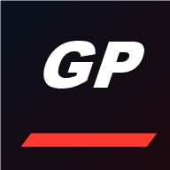
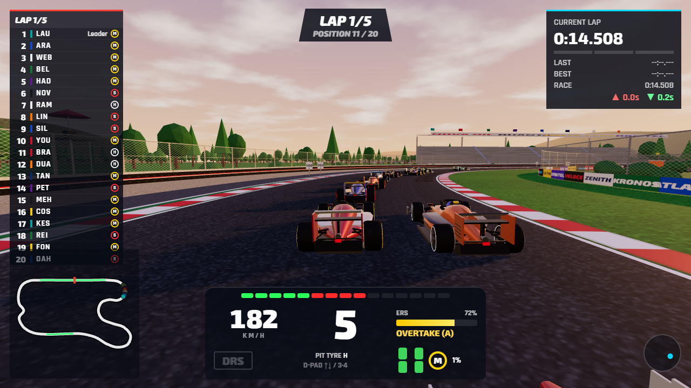
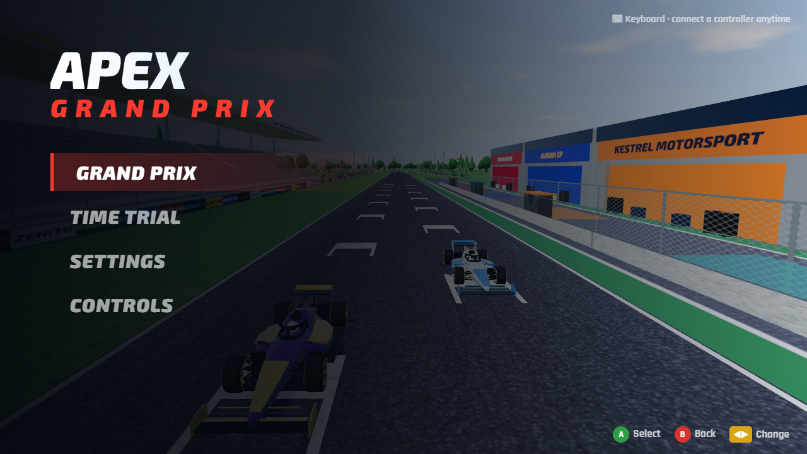
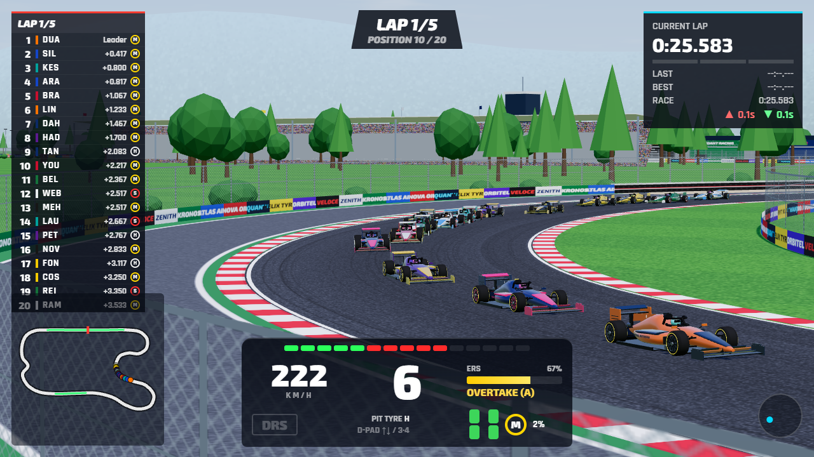
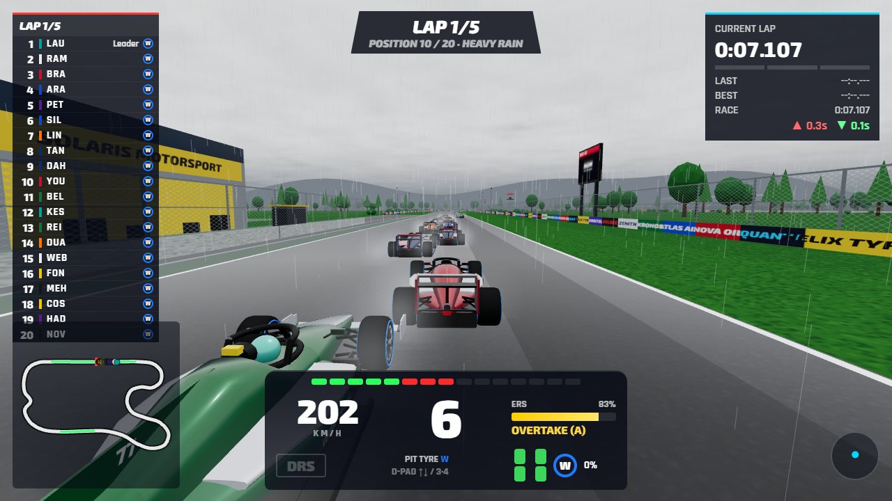
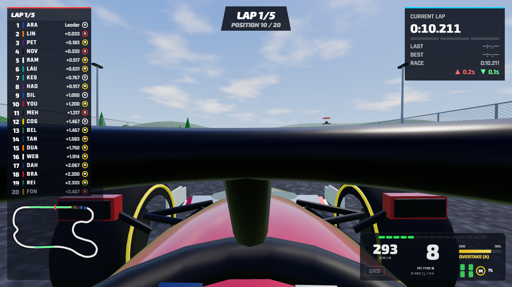
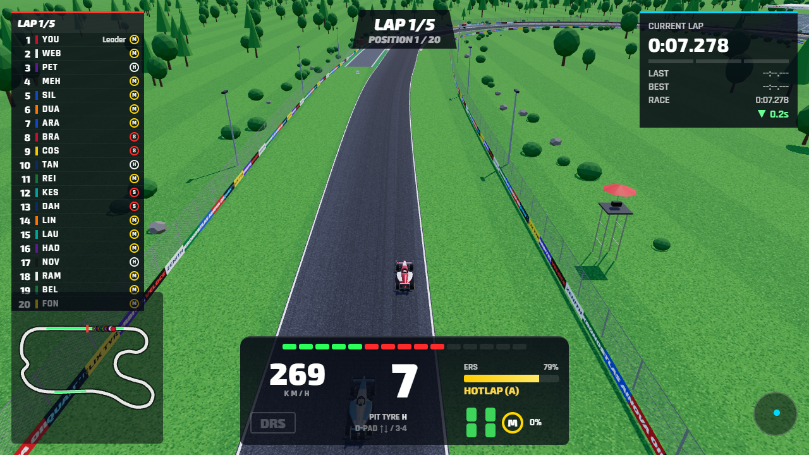
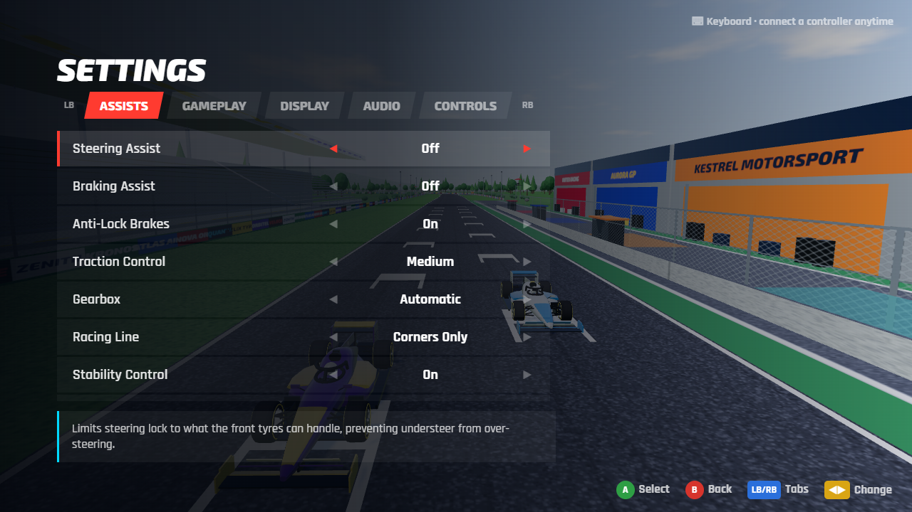
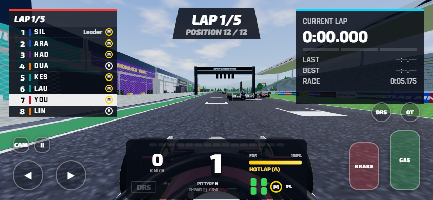

<div align="center">



# Apex Grand Prix

**A 3D open-wheel racing game that runs right in your browser — and on your Android phone.**

Twenty cars. Five red lights. DRS, ERS, tyre strategy, pit stops and rain.

[](https://waynesimpson-spec.github.io/apex-grand-prix/)
[](https://github.com/waynesimpson-spec/apex-grand-prix/releases/latest/download/ApexGP.apk)
[](https://github.com/waynesimpson-spec/apex-grand-prix/releases/latest)

<br>



</div>

---

## 🏁 Play

| Platform | How |
|---|---|
| **Browser (PC / Mac / phone)** | Open **[waynesimpson-spec.github.io/apex-grand-prix](https://waynesimpson-spec.github.io/apex-grand-prix/)** in Chrome or Edge. On a phone you can tap **⋮ → Add to Home screen** to install it — it then works offline. |
| **Android app** | Download **[ApexGP.apk](https://github.com/waynesimpson-spec/apex-grand-prix/releases/latest/download/ApexGP.apk)**, tap it, and allow installing from your browser / files app when asked. Android 7+, fully offline. |
| **Windows (local)** | Download the code and double-click `Play Apex GP.bat`. |

Plug in an **Xbox or PlayStation controller** at any time — it's picked up automatically (with vibration).

## 📸 Screenshots

<table>
  <tr>
    <td></td>
    <td></td>
  </tr>
  <tr>
    <td align="center"><sub>Main menu</sub></td>
    <td align="center"><sub>TV broadcast camera</sub></td>
  </tr>
  <tr>
    <td></td>
    <td></td>
  </tr>
  <tr>
    <td align="center"><sub>Heavy rain — spray, wet track, full wet tyres</sub></td>
    <td align="center"><sub>First person cockpit</sub></td>
  </tr>
  <tr>
    <td></td>
    <td></td>
  </tr>
  <tr>
    <td align="center"><sub>Helicopter cam over the pit straight</sub></td>
    <td align="center"><sub>Settings — assists, gameplay, display, audio, controls</sub></td>
  </tr>
</table>

<div align="center">
<br>
<sub>On a phone: steering buttons, pedals, DRS and ERS overtake — or steer with the swipe slider or by tilting</sub>
</div>

## ✨ Features

**Racing**
- 🤖 **19 AI rivals** with difficulty from 0 to 110 — they brake, overtake, defend, use DRS/ERS and make their own pit stops
- 🚦 **Race weekend feel** — five-light starts, sector times (purple / green / yellow), fastest laps, chequered flag and points
- 🛞 **Tyre strategy** — Soft, Medium, Hard, Intermediate and Full Wet, with wear that costs grip
- 🔧 **Pit stops** — dive into the pit lane, the car drives the 80 km/h limiter to your garage and fits fresh tyres
- ⚡ **DRS & ERS** — DRS within a second of the car ahead; four ERS modes with a battery that recharges under braking
- 🌧️ **Weather** — dry, light rain, heavy rain: spray, wet reflections, fog and much less grip on slicks

**Driving**
- Car physics with downforce, weight transfer and tyre grip; an 8-speed gearbox with automatic or manual shifting
- Full assists like the big racing games: stability control, steering, braking, ABS, traction control, racing line, DRS and ERS
- **9 cameras** — T-Cam, cockpit, helmet, nose, rear wing, third person, far chase, helicopter and TV broadcast, plus free look

**World**
- Two original circuits: **Costa Verde Circuit** and **Nordhavn Ring**
- Grandstands with flags, team garages and paddock, TV camera towers, a live timing big screen, bridge, floodlights, marshal posts, distance boards, rubbered-in racing line and skid marks
- Detailed cars: wings with working DRS flap, halo, steering wheel, glowing brake discs, team liveries and race numbers
- V12-style engine audio and synthwave menu music

## 🎮 Controls

| Action | Controller | Keyboard | Touch |
|---|---|---|---|
| Steer | Left stick | A / D or ← / → | ◀ ▶ · slider · tilt |
| Throttle / Brake | RT / LT | W / S or ↑ / ↓ | GAS / BRAKE |
| Shift up / down (manual) | RB / LB | E / Q | + / − |
| DRS | A | Space | DRS |
| ERS overtake (hold) | B | F | OT |
| ERS mode | D-pad ← / → | 1 / 2 | — |
| Pit tyre choice | D-pad ↑ / ↓ | 3 / 4 | — |
| Change camera | X | C (V = previous) | CAM |
| Look around / back | Right stick / Y | Z, X / B | — |
| Reset car to track | View | R | — |
| Pause | Menu | Esc | ❚❚ |

> **Pitting:** drive into the pit lane on the **left**, just before the start/finish line. Choose your next tyre first with the D-pad (or 3 / 4).

## 🛠️ Tech

- One self-contained `index.html` — HTML, CSS and JavaScript using [three.js](https://threejs.org/) r160 for 3D. No build step.
- Everything is generated in code: track geometry from splines, cars from lofted shapes, textures drawn on canvas, audio synthesised with the Web Audio API.
- Installable web app (`manifest.json` + `sw.js` service worker) when served over HTTPS, e.g. GitHub Pages.
- `android/` is a small WebView app that serves the game from the APK, so it runs offline.

### Building the APK

The build script uses the Android SDK tools directly (no Gradle):

```powershell
powershell -ExecutionPolicy Bypass -File android\build-apk.ps1
```

It needs JDK 17, Android SDK platform 34 + build-tools 34.0.0, and three.js 0.160 (`three.module.js`, `BufferGeometryUtils.js`) — paths are set at the top of the script. On first run it creates a signing key, `android/apexgp.keystore`, which is git-ignored: back it up, because updates to an installed app must be signed with the same key.

### Project layout

```
index.html              the whole game
sw.js, manifest.json    offline / installable web app
icon-192.png, icon-512.png
Play Apex GP.bat        Windows launcher
android/                Android WebView app + build script
docs/screenshots/       images used in this README
```
